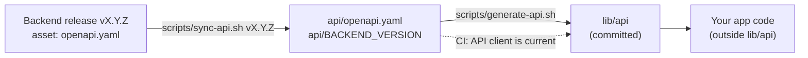

# Consuming the backend API

For an app that talks to a backend built from the Django template. The two developers agree
on the API through **one written contract**, an OpenAPI file that the backend generates from
its code and publishes with every release. This page covers the Flutter side: pinning a
release of that contract, generating a typed client from it, keeping the two in step, and
configuring where the app finds the server.

The working agreement between the two developers (who decides what, how an endpoint is
requested and reviewed) lives in the backend repository, not here:
[`docs/api-collaboration.md`](https://github.com/alihaidar0/django-template/blob/main/docs/api-collaboration.md)
and
[`docs/consuming-the-api.md`](https://github.com/alihaidar0/django-template/blob/main/docs/consuming-the-api.md).
API requests are issues in the **backend** repository; link one from a task here as
`owner/backend-repo#12`.

Everything below is optional and inert until a project opts in: the template ships the
scripts and the configuration, but no Flutter code, no packages and no contract.



## 1. One-time setup (after `flutter create`)

1. **Name the backend repository.** One line, `OWNER/REPO`:

   ```bash
   mkdir -p api
   echo 'your-account/your-backend' > api/BACKEND_REPO
   ```

2. **Add the packages.** The generator writes
   [Retrofit](https://pub.dev/packages/retrofit) clients on top of
   [Dio](https://pub.dev/packages/dio) with `json_serializable` models, so the app needs the
   runtime packages and the code generators:

   ```bash
   flutter pub add dio retrofit json_annotation
   flutter pub add --dev build_runner json_serializable retrofit_generator swagger_parser
   ```

   `pubspec.lock` pins the exact versions. If you prefer `freezed` or `dart_mappable` models,
   set `json_serializer` in `swagger_parser.yaml` and follow the package's README for the extra
   packages and its `build.yaml`.

3. **Check `swagger_parser.yaml`.** The template ships it at the repository root: contract in
   `api/openapi.yaml`, client in `lib/api`, Dart with `json_serializable`, one root client.

4. **Keep the analyzer quiet about generated code**, if `flutter analyze --fatal-infos`
   reports lints inside it. In `analysis_options.yaml`:

   ```yaml
   analyzer:
     exclude:
       - lib/api/**
   ```

5. **Pin a release and generate the client** (section 2), then commit `api/` and `lib/api`.

## 2. Pin a release and generate the client

```bash
scripts/sync-api.sh v1.4.0
```

It downloads the `openapi.yaml` asset of that backend release with the GitHub CLI, writes it
to `api/openapi.yaml`, records the release in `api/BACKEND_VERSION`, and regenerates `lib/api`
(`swagger_parser`, then `build_runner`, then `dart format`). Nothing is written when the
download fails, so the contract and its version note never disagree.

| Command | What it does |
| --- | --- |
| `scripts/sync-api.sh vX.Y.Z` | Pin a release and regenerate the client |
| `scripts/sync-api.sh --commit <sha>` | Before the backend's first release: pin `openapi/schema.yaml` at that commit (the full SHA is recorded) |
| `scripts/sync-api.sh vX.Y.Z --no-generate` | Pin only |
| `scripts/sync-api.sh vX.Y.Z --require-verified` | Fail unless the release attestation verifies (see below) |
| `scripts/generate-api.sh` | Regenerate `lib/api` from the pinned contract (after changing `swagger_parser.yaml` or upgrading a generator) |

- **Private backend.** Run `gh auth login` with an account that can read the repository (the
  token stays in `gh`'s own store; the scripts never print or save it). In CI use a
  fine-grained token with read-only *Contents* access to that one repository, as a secret.
- **Verification.** The backend template requires *Immutable releases* on the backend
  repository, so each release carries a signed attestation. The script checks the downloaded
  file against it with `gh release verify-asset` (GitHub CLI 2.81 or newer, which the dev
  image provides). If a release has no attestation, for example because the setting was off
  when it was published, the script says so and carries on; add `--require-verified` to make
  that an error.
- **Commit** `api/openapi.yaml`, `api/BACKEND_VERSION` and `lib/api` together. Generated code
  is committed so a contract change is a reviewable diff, and `lib/api/**` is marked as
  generated, so the pull request view folds it by default. The contract file is a verbatim
  copy of the release asset: do not edit it (CI skips the whitespace check for it so that it
  stays byte-identical).
- **Never edit `lib/api` by hand.** Change the contract (through the backend) or
  `swagger_parser.yaml`, then regenerate.

## 3. The CI check: API client is current

When a pull request has both `pubspec.lock` and `api/openapi.yaml`, the **API client is
current** job of `ci.yml` runs `scripts/generate-api.sh` and fails if `lib/api` differs from
what is committed (including files that were generated but never committed). It feeds the
required **CI passed** check. It is skipped on a fresh template and in an app without a
contract. If it fails, run `scripts/generate-api.sh` locally and commit the result.

## 4. Move to a new backend release

1. Read the release notes of the backend and look for entries labelled `breaking change`.
2. Run `scripts/sync-api.sh vX.Y.Z` with the new tag.
3. Let the compiler (`fanalyze`) show what changed, and fix the app code.
4. Open a pull request with `api/` and `lib/api`. Merge when the app builds and its tests pass.

A breaking change needs both developers' agreement and the `breaking change` label on the
backend side before it is released; the release notes are where the app developer sees it.

### Be told about new releases (optional)

The `backend-contract.yml` workflow runs every Monday, compares `api/BACKEND_VERSION` with the
newest release of the backend and keeps **one** issue open (label `dependencies`) while a newer
release exists. The issue links the release notes and repeats the steps above; it closes by
itself once the app is current. An issue rather than a pull request, because Actions may not
open pull requests in this setup.

It is off until you opt in. In the repository settings (**Settings → Secrets and variables →
Actions**):

| Kind | Name | Value |
| --- | --- | --- |
| Variable | `BACKEND_REPO` | `OWNER/REPO` of the backend. Without it the workflow does nothing |
| Secret | `BACKEND_READ_TOKEN` | Only for a private backend: a fine-grained token with read-only *Contents* access to that one repository |

A public backend needs no token. If the backend cannot be read, the run fails (red) instead of
reporting "up to date". You can also start it by hand from **Actions → Backend contract**.

## 5. Where the app finds the server

### Never hard-code the base URL

The URL differs per environment, so it is a build-time value. Read it with
`String.fromEnvironment` and give it to Dio:

```dart
// lib/core/api_client.dart: your code, outside the generated lib/api
import 'package:dio/dio.dart';

import '../api/rest_client.dart'; // generated; check the file name in lib/api

const _baseUrl = String.fromEnvironment('API_BASE_URL');

RestClient createApiClient(Interceptor authInterceptor) {
  assert(_baseUrl.isNotEmpty, 'Run with --dart-define=API_BASE_URL=...');
  final dio = Dio(BaseOptions(baseUrl: _baseUrl))
    ..interceptors.add(authInterceptor);
  return RestClient(dio);
}
```

- **Staging and production builds.** `build.yml` already passes
  `--dart-define-from-file=env/<environment>.json` when the file exists. Put the public value
  there, for example `env/staging.json`: `{"API_BASE_URL": "https://api.staging.example.com"}`.
  A value given with `--dart-define` is compiled into the app and can be read from it, so it
  must never hold a secret.
- **Local runs.** Add the define to the arguments of your launch configurations in
  `.vscode/launch.json` (next to `deviceId`): `"args": ["--dart-define=API_BASE_URL=http://10.0.2.2:8000"]`
  for the Android emulator, and `"--dart-define=API_BASE_URL=http://localhost:8000"` for the web
  one (keep its `--web-port` and `--web-hostname` arguments).

### Reaching a backend that runs on your machine

The app code runs on the **emulator** or in the **browser**, both on your host, never in the
dev container. So the backend (in its own dev container, with port 8000 published to the host)
is reached through the host. `host.docker.internal` is only used for adb and is the wrong
address for the API.

| Where the app runs | Base URL | Also needed |
| --- | --- | --- |
| Android emulator on the host | `http://10.0.2.2:8000` (the emulator's alias for the host's loopback) | `10.0.2.2` in the backend's `ALLOWED_HOSTS`, and the cleartext exception below |
| Browser on the host (`frunw`, port 8080) | `http://localhost:8000` | The app origin `http://localhost:8080` allowed by the backend's CORS settings, because the two ports are different origins |
| A phone on your network | `http://<your host's LAN address>:8000` | The same as the emulator, and the host's firewall open for the port |
| Staging, production | `https://...` | Nothing: HTTPS needs no exception |

**Cleartext HTTP on Android.** Android blocks plain `http://` by default. Allow it for the
local addresses in **debug builds only**, in the project's `android/` folder (created by
`flutter create`). In `android/app/src/debug/AndroidManifest.xml`, add to the `<manifest>`:

```xml
<application android:networkSecurityConfig="@xml/network_security_config" />
```

and create `android/app/src/debug/res/xml/network_security_config.xml`:

```xml
<?xml version="1.0" encoding="utf-8"?>
<network-security-config>
  <domain-config cleartextTrafficPermitted="true">
    <domain includeSubdomains="false">10.0.2.2</domain>
    <domain includeSubdomains="false">localhost</domain>
  </domain-config>
</network-security-config>
```

Release builds keep the default (HTTPS only). Flutter documents the same approach in its
[network policy](https://docs.flutter.dev/release/breaking-changes/network-policy-ios-android)
note.

## 6. Keep out of the generated code

- **Authentication.** The contract describes the security scheme, but the token handling is the
  app's own code: a Dio `Interceptor` (attach the token, refresh it on `401`) in a folder
  outside `lib/api`, and the token in secure storage, never in the repository.
- **Errors.** Parse errors in one place instead of handling `DioException` in each screen. The
  shape is whatever the backend implements: the backend template only recommends RFC 9457
  problem details (`application/problem+json`, in its `docs/api-conventions.md`) and ships no
  handler, so do not assume it until the project has one. Until then Django REST framework's
  defaults apply: `{"detail": "..."}` for most errors and `{"field": ["message"]}` for
  validation errors. Check the error responses in `api/openapi.yaml` and adapt:

  ```dart
  String describeError(DioException e) {
    final response = e.response;
    if (response == null) return 'Cannot reach the server';
    final data = response.data;
    if (data is Map<String, dynamic>) {
      final message = data['detail'] ?? data['title'];
      if (message != null) return message.toString();
    }
    return 'Request failed (${response.statusCode})';
  }
  ```

- **Decimals arrive as strings.** A decimal field (money, quantities) is declared in the
  contract as `type: string, format: decimal`, so the generated model holds a `String`. Parse
  it into a decimal type (for example the `decimal` package) at the edge of the app, never into
  `double`, and format amounts for display only.
- **Tests and fixtures** use invented data only, never a copy of real responses.

## 7. Flutter web

When the same Flutter code also builds for the web, one generated client serves both targets;
there is nothing more to set up besides the base URL and CORS above. A separate web app in
another stack (React, Vue, ...) is its own repository: it pins the same release asset and
generates types with `openapi-typescript` and a client with `openapi-fetch`, as described in the
backend's `docs/consuming-the-api.md`. Nothing for it lives in this template.

## Checklist for a change that touches the API

- [ ] `api/openapi.yaml` comes from a release (or an approved commit) and
      `api/BACKEND_VERSION` says which
- [ ] The client was regenerated with `scripts/generate-api.sh`, not edited by hand
- [ ] **API client is current** is green
- [ ] The base URL comes from `API_BASE_URL`, not from the source
- [ ] No token, password or real data in the repository, the tests or the fixtures
